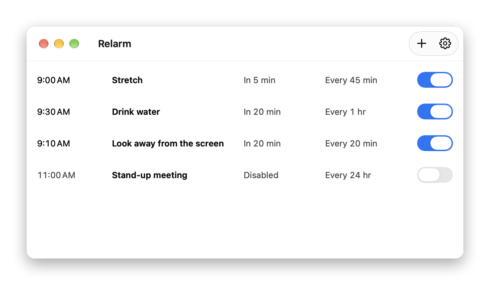
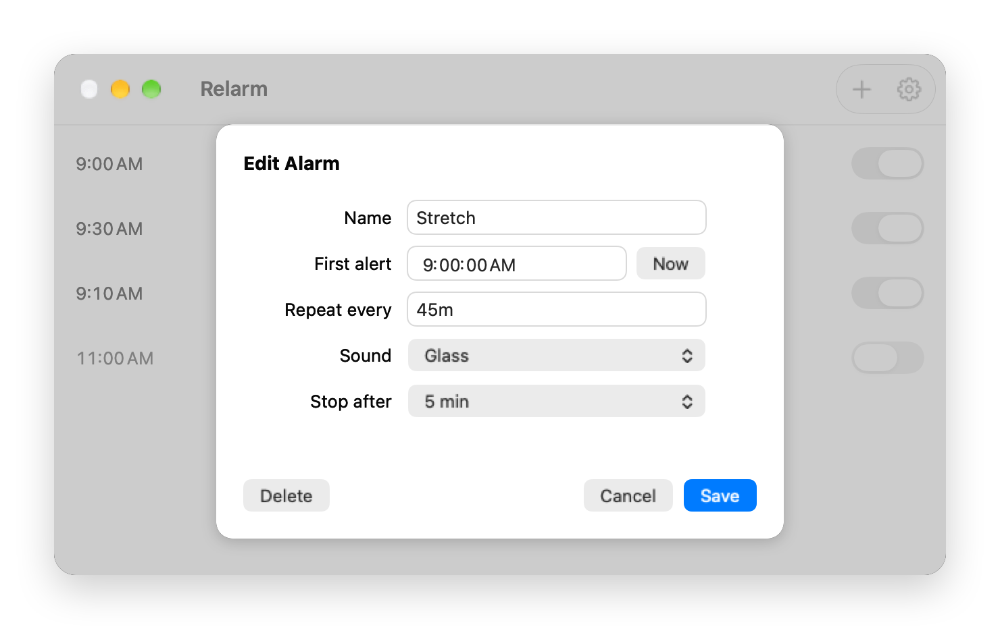

# Relarm

A minimal menu bar app for repeating alarms on macOS.

Relarm is for reminders that come back on a schedule, like a stretch every 45
minutes or a glass of water every hour. Pick a first alert time and an
interval, and the alarm keeps ringing at that cadence until you switch it off.

<picture>
  <source media="(prefers-color-scheme: dark)" srcset="docs/alarms-dark.png">
  
</picture>

## Features

- Lives in the menu bar, with the next alarms one click away
- Repeats every `90s`, `5m`, `1h 30m` or any other interval
- Rings until you stop it from the notification
- Shows a live countdown to each alarm's next ring
- Turns alarms on and off with a switch
- Duplicates an alarm from its right-click menu
- Skips alarms missed while the app was closed

<picture>
  <source media="(prefers-color-scheme: dark)" srcset="docs/form-dark.png">
  
</picture>

## Install

```sh
brew install --cask nikhilweee/tap/relarm
```

Then launch Relarm from /Applications. The app is ad-hoc signed because it has
no Apple Developer account behind it. The cask clears the quarantine flag after
install, so Gatekeeper lets the first launch through.

Or download `Relarm.dmg` from the
[latest release](https://github.com/nikhilweee/relarm/releases/latest) and drag
Relarm into Applications. Gatekeeper blocks the first launch of a downloaded
app that isn't notarized. Open System Settings › Privacy & Security and click
Open Anyway.

## Build from source

```sh
./build.sh
open Relarm.app
```

This builds `Relarm.app`, plus a `Relarm.zip` and a `Relarm.dmg` to
distribute. With full Xcode the app is universal (arm64 and x86_64). Under
CommandLineTools it targets only your Mac's architecture.
